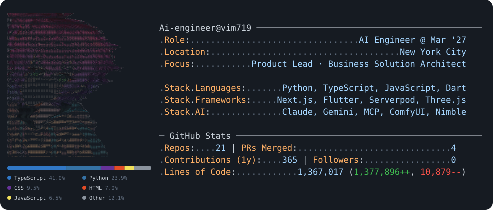

<picture>
  <source media="(prefers-color-scheme: dark)" srcset="dark_mode.svg">
  <source media="(prefers-color-scheme: light)" srcset="light_mode.svg">
  
</picture>

<picture>
  <source media="(prefers-color-scheme: dark)" srcset="https://raw.githubusercontent.com/vim719/vim719/output/github-snake-dark.svg">
  <source media="(prefers-color-scheme: light)" srcset="https://raw.githubusercontent.com/vim719/vim719/output/github-snake.svg">
  
</picture>

### Projects
- **[3Dfi](https://3dfi-chi.vercel.app)** ([repo](https://github.com/vim719/3Dfi)) - open-source AI 3D asset foundry: image-to-3D with TRELLIS.2 ComfyUI workflows, a scene-building agent over a 1,000+ asset parametric library, live reshape / recolor / remix, GLB export
- **[NimbleBuddy](https://vim719.github.io/NimbleBuddy/)** ([repo](https://github.com/vim719/NimbleBuddy)) - Anna, a real-time voice AI companion with cross-session memory and live Nimbleway web search over MCP, plus a Chrome extension and a cited Market Pulse view
- **[Nimble-Buddy](https://nimblebuddy.v0.build)** ([repo](https://github.com/vim719/Nimble-Buddy)) - speak a task, it gets done on the live web: Nimble Web Search Agents returning cited, confidence-scored claims, live price comparison, page extraction (AI Engineer NYC 2026)
- **[Shadow CFO](https://shadow-cfo.vercel.app)** ([repo](https://github.com/vim719/Shadow-CFO)) - self-improving AI financial agent that finds annual financial leakage and acts on it with user approval
- **[LiftMeUp](https://github.com/vim719/LiftMeUp)** - one prioritized ledger of NYC DOB elevator compliance across a property portfolio: auto-calculated due dates, DOB Open Data address lookup, AI risk briefing
- **[ServerBuddy](https://github.com/vim719/ServerBuddy)** - voice companion with long-term memory on Serverpod 4 + Flutter (type-safe Dart client, Postgres ORM)
- **[SignalForge](https://signalforge-sepia.vercel.app)** ([repo](https://github.com/vim719/signalforge)) - autonomous execution relay for memecoin signals: Telegram / Birdeye / Helius → Redis queue → 0G agent → KeeperHub
- **[AirClaw](https://airflow-tan.vercel.app)** ([repo](https://github.com/vim719/airflow)) - Next.js 14 live signal dashboard with an interactive stack map and a streaming Claude design-system builder

### Skills

